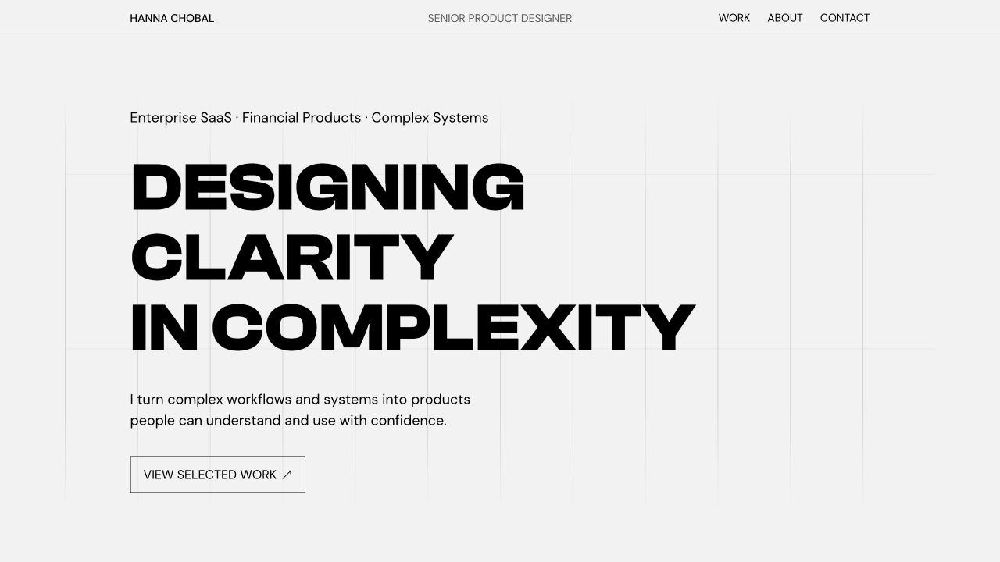

# Hanna Chobal — Product Design Portfolio

I am a Senior Product Designer with 8+ years of experience designing complex financial and enterprise products. This portfolio brings together selected case studies and interactive prototypes, with an emphasis on clear workflows, useful information and considered interaction details.

**[Explore the live portfolio →](https://hannachobal.com/)**



## Selected work

| Project | What to explore |
| --- | --- |
| [Service Workspace](https://hannachobal.com/work/service-workspace/workflow.html) | A configurable service-workspace concept for reviewing evidence and coordinating complex requests. Explore the interactive workflow, panels and interface states. |
| [Trading Platform](https://hannachobal.com/work/trading-experience/case.html) | A connected mobile journey from market overview and research to order entry, supported by web and mobile prototypes. |
| [B2B Market Analysis](https://hannachobal.com/work/market-analysis/) | A self-service experience for defining markets, exploring patterns and investigating company data. |

All three projects are open to view. Each project describes its context and my contribution. Concepts and portfolio prototypes are presented as demonstrations; their presence here does not imply that every interaction shipped in a production product.

## My contribution

I own the portfolio's content, information architecture, visual direction, interaction decisions and final review. The individual case studies explain my role in each project.

My process connects the problem and product story with the interface: structure the experience, explore alternatives, prototype interactions, implement the presentation, and refine it in desktop and mobile contexts. I have used Figma and prototyping throughout my design career.

## AI-assisted implementation

I use AI coding tools to help implement, debug and refine the website and prototypes. I direct the design, review the output and make the final decisions about content and behavior.

This repository shows product design translated into a working browser experience. The code includes AI-assisted implementation.

## Run locally

Requires Node.js 18 or later. No packages or build step are needed.

```sh
node preview.mjs
```

Open **http://127.0.0.1:8767**. The preview supports the extensionless links used by the projects. Stop the server with `Ctrl+C`.

## Repository guide

- `index.html` — portfolio homepage
- `work/service-workspace/` — interactive Service Workspace concept
- `work/trading-experience/` — Trading Platform case study and prototypes
- `work/market-analysis/` — B2B Market Analysis case study
- `assets/` and `protected-assets/` — images, fonts and prototype resources; `protected-assets` is a legacy folder name, and these included resources are open
- `docs/` — repository previews
- `preview.mjs` — local static preview server

This is a curated source snapshot of the portfolio, prepared on 5 November 2026. Local visual explorations, working notes, production credentials and deployment configuration are excluded. Analytics is disabled in this copy. The live website is maintained separately; publishing this repository does not deploy the site.

## Rights and credits

Portfolio content, case-study materials and original visuals are presented for review. No blanket reuse license is granted for them. Third-party brands, fonts and libraries remain subject to their respective owners' rights and licenses. Lightweight Charts license and notice files are retained in `assets/vendor/lightweight-charts/`.
